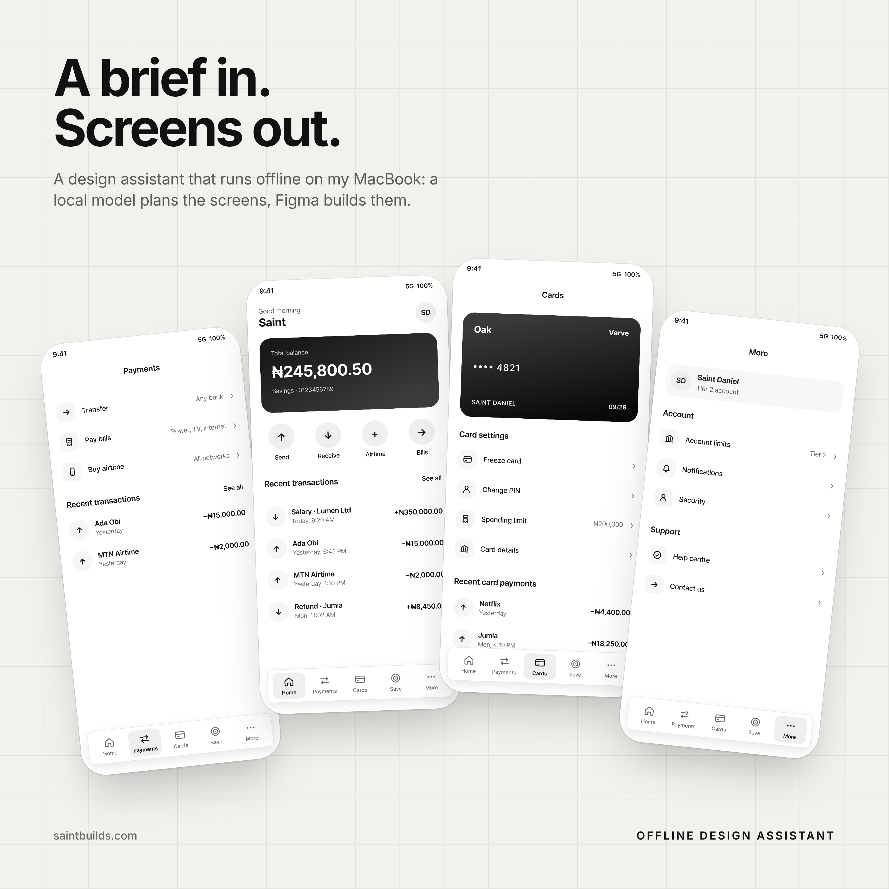

# Saint Local Designer



An offline design assistant. You write a brief, a local model (Gemma 4 via Ollama) plans the screens as structured JSON, and a Figma plugin builds them as native frames with auto layout, real text and prototype links. No cloud AI, no API keys.

I built it as a fallback in case access to hosted models gets restricted, and as a way to test how far a small local model can go on real design work.

## How it works

1. `designer.py` builds a prompt from the brief, layout rules (`rules/`), a brand file (`brands/`) and approved past work as few-shot examples.
2. Gemma returns a JSON layout tree. The script validates it and swaps token names for real values.
3. The Figma plugin (`figma-plugin/`) receives the JSON over a local websocket and builds the frames.
4. The model renders and reviews its own output once, then you approve, revise or discard.
5. Every run is logged. Approved and hand-corrected screens become examples for later runs and training data for a LoRA fine-tune (`TRAINING.md`).

## Status

Working, but below frontier-model quality. Small models do best on 2–4 screens per run with specific briefs. The open question I'm exploring is how much the gap closes with a good component library and fine-tuning on corrected work.

## Setup (once)
1. Open the Ollama app. Check `ollama list` shows a gemma4 model.
2. `cd` into this folder and run `bash setup.sh`
3. Figma desktop → Plugins → Development → Import plugin from manifest → `figma-plugin/manifest.json`
4. Optional: install Wix Madefor Display on your Mac so Figma can use it (Inter is used if it's missing).

## Use
1. Open your Figma file and run **Plugins → Development → Saint Local Designer** (keep its little window open).
2. In Terminal:
```
./design "Onboarding: welcome, phone number, OTP, create 6-digit PIN"
./design "Savings goal detail with top-up" --ref ~/Desktop/ref1.png --ref ~/Desktop/ref2.png
./design "Same layout, for the Health tab" --ref-selection     # frames selected in Figma = references
./design "Landing screens for a bakery app" --brand generic
```
3. It builds the screens in a new section, reviews its own render once, then asks for feedback.
   Type changes ("tighter spacing, move balance up") to revise, `ok` to approve, `q` to discard.

## Make it design more like you
- **Approve good results** (`ok`). Approved work is fed back as examples on every new run.
- **Harvest your fixes.** After fixing a result by hand, select the screens and run `./design harvest`. Your corrected version becomes the best example. This matters more than anything else.
- **Components.** If the Figma file has components (Button, Input, List row, Tab bar), the model uses them instead of rebuilding. A good component library is the biggest quality jump you can give a small model.
- **Brands.** `brands/<name>.md` (rules) + `brands/<name>.tokens.json` (colours, fonts, frame size). Copy `generic` for a new client.
- **Extra rules.** Anything in `rules/extra.md` is added to every prompt.

## Model choice (18 GB M3 Pro)
- Default `gemma4` (E4B, ~10 GB) runs comfortably.
- If a ~12B Gemma 4 tag is available in Ollama, try it: better layouts, slower. Change `"model"` in `config.json`.
- 26B/31B won't run well on 18 GB.
- Slow or out of memory? Lower `num_ctx` in config.json to 8192, use `--no-review`, ask for 2–3 screens per run.

## Tips
- Small models do better with small jobs: 2–4 screens per run, one flow at a time.
- Be specific: list what's on each screen. "Home: balance card, 4 quick actions, recent transactions, tab bar".
- `--dry` prints the JSON without touching Figma.

## Folders
- `dataset/runs/` every run: brief, references, each version's JSON and PNGs
- `dataset/approved/` approved + harvested work (few-shot examples and training data)
- `TRAINING.md` fine-tuning on your own work, once you have enough of it
